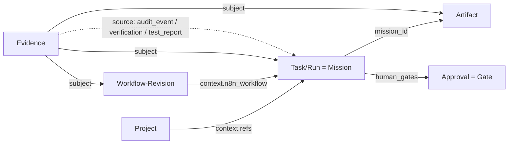

# Factory-Modul-SDK – Spezifikation Version 1.0.0 (SEDRA-MOD-03)

| Feld | Wert |
|---|---|
| Auftrag | SEDRA-MOD-03, G1 vom 06.11.2026 (eng begrenzt: reine Spezifikation) |
| Status | `SPEC_APPROVED` (G1) → Abgabe `CODER_HANDOFF`; G2 (Design) steht aus |
| Basis | `c6960fa` (`origin/main`, GitHub); alle Fundstellen gelten für diesen Stand. `runtime/src/` ist zwischen `2b13daa` und `c6960fa` unverändert (`git diff --stat 2b13daa c6960fa -- runtime/src` leer), die Zeilen sind dieselben |
| Coder | Coder 2 |
| Herkunft | Text und Schemata `NEW_AI_GENERATED`; jede Abbildung nennt ihre Fundstelle (`EXISTING_REUSE`) |
| Dateien | dieses Dokument, `docs/factory_sdk/schemas/*.schema.json` (7), `docs/factory_sdk/beispiele/*.json` (12) |

## 1. Zweck und Grenzen

Das SDK beschreibt, **wie ein Factory-Modul die vorhandenen SEDRA-Bausteine sieht und anspricht**. Es legt sechs Verträge fest: Project, Workflow, Task/Run, Artifact, Evidence und Approval.

Grundsätze:

1. **Sicht, kein neuer Speicher.** Jedes SDK-Objekt ist eine Abbildung genau eines vorhandenen Datensatzes, oder (Evidence) ein Verweis auf vorhandene Datensätze. Das SDK führt keine eigene Ablage, keinen Zähler und keine eigene ID-Vergabe ein.
2. **Keine Rechte.** Ein gültiges Objekt erteilt nichts. Gültigkeit heißt nur: die Form stimmt. Das gilt wie bei `workflows/schema.py` („this validation never grants execution rights“). Ausgeführt wird weiter nur über Mission, Guard und Einmal-Token.
3. **Fail-closed.** Was das SDK nicht sicher erkennt, wird abgewiesen, nicht geraten (§2.2).
4. **Kein zweiter Kern.** Keine eigene Orchestrierung, keine eigene Freigabe, keine eigene Workflow-Engine. Die Factory nutzt die Mission (`core/mission.py`), das Schrittjournal (`core/step_journal.py`), den Guard (`core/guard.py`) und `desk/gated.py`.
5. **Nicht in der Runtime.** Die Schemata sind Dokumentation und Prüfgrundlage. In Version 1 werden sie nicht als Prüfung in die Runtime eingehängt (G1-Verbot).

Nicht Teil dieser Fassung: Factory-Registry und Lebensdauer von Modulen (F2-01), Plugin-Laden, neue Antragsarten, UI (MOD-04), Dauerfreigaben (`standing`).

## 2. Gemeinsame Regeln

### 2.1 Versionierung

- Jedes Objekt trägt `schema_version` (SemVer) und `kind` (`factory.<objekt>`).
- Diese Fassung kennt **nur `1.0.0`**: `common.schema.json` → `schema_version` ist `const`.
- **Patch** (1.0.x): nur Beschreibungen und Beispiele, keine Formänderung.
- **Minor** (1.x.0): nur neue **optionale** Felder oder neue Enum-Werte. Wer 1.0.0 liest, weist ein 1.1.0-Objekt trotzdem ab (`schema_version` ist `const`, `additionalProperties: false`). Erst der Wechsel auf das neue Schema nimmt es an. Ein Minor-Wechsel braucht deshalb eine neue Schemadatei und eine Gate-Entscheidung.
- **Major** (2.0.0): alles andere. Major ist nur mit neuem G1/G2 zulässig.
- Die Schemata haben `$id` der Form `urn:sedra:factory-sdk:1:<objekt>`. Die Ziffer im URN ist die Major-Version. Diese Kennungen sind Namen, keine Netzadressen. Es wird nichts nachgeladen.

### 2.2 Fail-closed (gilt für jedes Objekt)

| Nr. | Regel | Wirkung |
|---|---|---|
| FC-1 | unbekannte `schema_version` oder falsches `kind` | abweisen |
| FC-2 | unbekanntes Feld (`additionalProperties: false` auf jeder Ebene) | abweisen |
| FC-3 | unbekannter Enum-Wert (Phase, Status, Ergebnis …) | abweisen, nicht auf einen Standard abbilden |
| FC-4 | Datensatz in der Quelle fehlt (`backing_not_found`) | abweisen; das SDK erzeugt ihn nicht |
| FC-5 | Digest oder Hash stimmt nach Neuberechnung nicht (`integrity_failed`) | abweisen; wie `WorkflowStore.read` (`workflow_integrity_failed`) |
| FC-6 | Schritt `RUNNING` ohne laufenden Besitzer | Ausgang `unknown`; **nie automatisch wiederholen** (`core/step_journal.py:81`, `UNKNOWN_EXECUTION_OUTCOME`) |
| FC-7 | Approval nicht `resolved` + `APPROVE_ONCE` | nichts ausführen; auch `resolved` + `APPROVE_ONCE` reicht nicht, erst `guard.authorize` mit Token |
| FC-8 | Nachweis `SKIPPED`, `NOT_RUN` oder `BLOCKED` | gilt nie als bestanden; Begründung Pflicht |
| FC-9 | Pfad absolut, mit Laufwerk, Backslash oder `..` | abweisen (`common.schema.json` → `relative_path`) |
| FC-10 | Geheimnis im Objekt (Token, Schlüssel) | abweisen; Approval verbietet `token`, `token_id`, `approval_token` ausdrücklich |

### 2.3 Gemeinsame Typen (`common.schema.json`)

| Typ | Muster | Quelle im Bestand |
|---|---|---|
| `sha256` | 64 Hex, klein | `core/util.py` `sha256_file`; `core/request_binding.py:7` `digest` (JSON mit `sort_keys`, `separators=(',',':')`, `ensure_ascii=False`) |
| `timestamp` | ISO 8601 mit `+00:00` | `core/util.py:7` `utcnow()` |
| `registry_project_id` | `PRJ-` + 12 Hex | `projects.py:12 ff.` |
| `harness_project_id` | `[a-z0-9][a-z0-9-]{0,39}` | `harness/projekte.py:22` |
| `workflow_id` | `WF-` + 24 Hex | `workflows/store.py` `_folder` |
| `mission_id` | `M-[A-Za-z0-9_-]{1,64}` | `core/mission.py` `MissionStore.path` |
| `artifact_id` | `ART-` + 8 Hex groß | `artifacts.py:14` |
| `gate_id` | `HG-` + 8 Hex groß | `core/guard.py:76` |
| `audit_event_id` | `EVT-` + mind. 6 Ziffern | `core/audit.py:41` |
| `step_id` | `[A-Za-z][A-Za-z0-9_-]{0,63}` | `core/step_journal.py` `plan_steps` |

## 3. Verträge

### 3.1 Project (`project.schema.json`)

**Baustein:** `ProjectRegistry` (`projects.py:5`, Datensatz `projects.py:19`, Ablage `runtime_data/projects.json`) **oder** Harness-Projekt (`harness/projekte.py`, `local_config/harness_projekte.yaml`).

| SDK-Feld | Quelle |
|---|---|
| `backing.store` = `project_registry` | `project_id`, `workspace_path` (`projects/PRJ-…`), `qualification` (`MANAGED_WORKSPACE_NOT_VM`), `created_at` aus dem Registry-Datensatz |
| `backing.store` = `harness_projekt` | `project_id` = Harness-ID; Wurzel und Schreibbereich bleiben in der Harness und werden **nicht** gespiegelt (enthalten lokale Pfade) |
| `display_name` | `display_name` (Registry, 1–80 Zeichen) bzw. `name` (Harness) |
| `status` | nur `ACTIVE` (einziger Wert, den `ProjectRegistry.create` schreibt) |

**Zustände:** `ACTIVE`. **Beziehungen:** 1 Project → n Task/Run über `mission.context.refs[].project_id` (`uix_server.py:2046`, `:3109`). **Fehler:** FC-4, wenn `ProjectRegistry.get` `unknown_project_id` meldet oder der Arbeitsbereich fehlt (`projects.py` `get` prüft ihn).

### 3.2 Workflow (`workflow.schema.json`)

**Baustein:** `WorkflowStore` (`workflows/store.py`), eine Revision = eine Datei `runtime_data/workflows/WF-…/<000001>.json`, Datensatz `store.py:74–78`.

| SDK-Feld | Quelle |
|---|---|
| `workflow_id`, `revision`, `digest`, `record_digest`, `previous_revision`, `change_note` | gleichnamige Felder (`id` → `workflow_id`) |
| `name` | `workflow.name` |
| `process_model` | `workflows/process.py:12` `has_process` |
| `execution` | `workflows/policy.py:150` `assessment` → `{executable, profile, reason}`, Profil `n8n-local-data-v1` (`policy.py:7`) |

Die Definition (Knoten, Verbindungen) steht **nicht** im SDK-Objekt. Wer sie braucht, liest die Revision über den Store oder das Desk-Verb `revision_lesen`.

**Zustände:** Eine Revision ist unveränderlich. Eine neue Revision geht nur über `WorkflowStore.save` mit `base_revision` (optimistische Sperre). **Regeln im Schema:** Ein Prozessmodell ist nie ausführbar. `executable: true` ⇒ `reason: null`, `false` ⇒ `reason` Pflicht. Revision 1 hat kein `previous_revision`. **Fehler:** FC-5 (Kette, `store.py:31` `read`), FC-4.

### 3.3 Task/Run (`task_run.schema.json`)

**Baustein:** Mission (`core/mission.py:23` `new_mission`, Phasen `core/mission.py:9` `ALLOWED`) mit Schrittjournal (`core/step_journal.py`). Ein Workflow-Lauf ist eine Mission mit `context.n8n_workflow` (`workflows/desk.py:101`), sichtbar als Kind `workflow_run` (`workflows/desk.py:149`).

| SDK-Feld | Quelle |
|---|---|
| `mission_id` | `identity.mission_id` |
| `phase` | `lifecycle.phase` (12 Werte aus `ALLOWED`) |
| `status` | `lifecycle.status`: `active`, `closed`, `archived` |
| `project_refs[].project_id` | `context.refs[].project_id`; `workspace_path` wird nicht übernommen |
| `workflow_ref` | `context.n8n_workflow` `{id, revision, digest}` |
| `steps[]` | `execution.step_journal.steps[]`: `id` → `step_id`, `status`, `attempts`; `outcome` ist SDK-Ableitung (FC-6) |
| `result` | `result.qualification`, `result.accepted` (fehlt vor VERIFY → `false`), `result.tests_executed` |

**Zustände:** Phasen und Übergänge wie `ALLOWED`. Das SDK ändert keine Phase; es liest. Regeln im Schema:
- `COMPLETE`/`FAILED` ⇒ `status` ≠ `active` (`MissionStore.transition`, `core/mission.py:66`).
- `closed`/`archived` ⇒ Phase nicht `EXECUTE`/`VERIFY`/`REWORK` (Verb `schliessen`, `uix_server.py:2296`; `archived` `:2306`).
- Schritt `PENDING` ⇒ 0 Versuche; `RUNNING` ⇒ mindestens 1 Versuch und `outcome` Pflicht.
- `qualification` `PENDING` ⇒ `accepted: false`.

**Qualifikationen:** `PENDING` (`core/mission.py:44`), `ARTIFACT_ONLY`, `PREPARED_NOT_TESTED`, `VERIFIED_INVENTORY` (`core/brain.py:222`). `ARTIFACT_ONLY` heißt: es gibt ein Artefakt, **keine** fachliche Abnahme (so auch `docs/N8N_WORKFLOW_APP.md`).

### 3.4 Artifact (`artifact.schema.json`)

**Baustein:** `ArtifactStore` (`artifacts.py:6`, `register` `:9`, Datensatz `:14`, `job_id` `:15`), Index `index.json`.

| SDK-Feld | Quelle |
|---|---|
| `artifact_id`, `mission_id`, `integrity`, `provenance.{created_by, source_component, created_at}`, `status`, `job_id` | gleichnamig |
| `artifact_type` | `type`, im Bestand immer `file` |
| `path` | `path` **relativ** zum Arbeitsbereich der Mission (z. B. `M-…/n8n-result.json`); der Store führt den absoluten Pfad (Lücke L-A2) |

`provenance.evolution_id` wird nicht übernommen (Selbstentwicklung, kein Factory-Gegenstand). **Fehler:** FC-5, wenn `sha256_file` der Datei nicht `integrity.hash` ergibt. Das prüft auch das Schrittjournal (`core/step_journal.py`, `completed_artifact_changed`). FC-9 bei Pfaden.

### 3.5 Evidence (`evidence.schema.json`)

**Baustein:** keiner als eigener Speicher (Lücke L-E1). Version 1 **verweist** auf eine von drei vorhandenen Quellen:

| `source.type` | Quelle | Prüfung durch den Leser |
|---|---|---|
| `audit_event` | Eintrag in der Audit-Kette (`core/audit.py:32` `append`; `event_id` `:41`, `integrity.event_hash` `:47`) | Eintrag mit `event_id` lesen, `event_hash` vergleichen, Kette prüfen |
| `verification` | `mission.verification.evidence[index]` (`modules/verification.py:21`), übernommen in `result.evidence_refs` (`core/brain.py:223`) | Eintrag an dieser Stelle muss existieren |
| `test_report` | Artefakt mit einem Testbericht (`ArtifactStore`) | `integrity.hash` des Artefakts muss `source.hash` sein |

- `evidence_digest` = `digest()` über das Objekt ohne dieses Feld. Daraus entsteht eine Kennung ohne Zähler. Der Leser rechnet nach (FC-5).
- `subject` nennt genau einen Gegenstand: Task/Run, Artifact oder Workflow-Revision.
- `outcome` nutzt die Ergebnisbegriffe des Prozesses (`PASS`, `FAIL`, `SKIPPED`, `NOT_RUN`, `BLOCKED`). Nur `PASS` zählt als bestanden (FC-8).

### 3.6 Approval (`approval.schema.json`)

**Baustein:** Gate des Guard (`core/guard.py:76` `create_gate`; `approve` `:79`, `reject` `:82`, `_approve` `:89`, `authorize` `:119`). Angelegt in `mission.human_gates` über `desk/gated.py:58` `request`. Die Antragsart steht in `mission.context.gated_request` (`desk/gated.py:26`).

| SDK-Feld | Quelle |
|---|---|
| `gate_id`, `mission_id`, `status` | gleichnamig |
| `action`, `targets`, `risks`, `rollback_available`, `request_digest` | `request.exact_action`, `request.targets`, `request.risks`, `request.rollback_available`, `request.request_digest` |
| `decision`, `decided_at` | `resolution.decision` (`APPROVE_ONCE` oder `DENY`), `resolution.decided_at` |
| `single_use` | `validity.single_use` (immer `true`) |
| `request_kind` | `context.gated_request.kind`, falls vorhanden |

**Nie im Objekt:** der Token (`core/guard.py:96`, `APR-…`). Er geht nur an den, der ausführt, und nur über `guard.authorize`. **Zustände:** `pending` (keine Entscheidung) → `resolved` mit `APPROVE_ONCE` oder `DENY`. **Freigabeklasse:** Neue Factory-Antragsarten brauchen vor ihrer ersten Nutzung einen Eintrag in `desk/freigabeklasse.py`. Das erzwingt `tests/test_freigabe_vollstaendig.py`. Der Eintrag ist ein eigener Captain-Auftrag (IF-MOD-01, Z3). Diese Spezifikation legt **keine** neue Antragsart fest.

## 4. Beziehungen

| Von | Nach | Kardinalität | Schlüssel |
|---|---|---|---|
| Project | Task/Run | 1 : n | `project_refs[].project_id` |
| Workflow-Revision | Task/Run | 1 : n | `workflow_ref.{workflow_id, revision, digest}` |
| Task/Run | Artifact | 1 : n | `artifact.mission_id` |
| Task/Run | Approval | 1 : n | `approval.mission_id` |
| Evidence | Gegenstand | n : 1 | `subject` |

Ein Workflow ist im Bestand **keinem** Projekt zugeordnet. Der Store gilt für das ganze SEDRA-Projekt (Lücke L-W1).

## 5. Lücken zu den vorhandenen Bausteinen

| Nr. | Lücke | Wirkung auf v1 | Vorschlag (nicht umgesetzt) | Owner |
|---|---|---|---|---|
| L-P1 | Zwei Projektbegriffe: `ProjectRegistry` (`PRJ-…`) und Harness-Projekt | `backing` erlaubt beide; welcher für die Factory gilt, ist offen | Entscheidung vor G2 | Captain/Koordinator |
| L-P2 | Kein Projekt-Lebenszyklus außer `ACTIVE` | kein Archiv/Ende | eigener Auftrag, falls gebraucht | Coder 1 (Registry) |
| L-W1 | Workflow ohne Projektbezug | Factory kann Workflows nicht je Projekt trennen | Bezug über die Mission (`context.refs`), nicht im Store | G2 |
| L-T1 | Mission-`result` hat vor VERIFY kein `accepted` | SDK setzt `false` | – (Abbildungsregel) | – |
| L-T2 | Workflow-Lauf hat genau einen Schritt `N8N-1` (`workflows/desk.py:86 ff.`) | keine mehrstufige Factory-Pipeline aus einem Workflow | Pipeline als Missionsplan mit mehreren Schritten (bis 32, `plan_steps`) | F2-02 |
| L-A1 | Keine typisierten Artefakte (`type` immer `file`) | `artifact_type` nur `file` | Typen erst mit F2 (Minor-Version) | Coder 2 + Coder 1 |
| L-A2 | Store führt absolute Pfade | SDK braucht eine Umrechnung relativ zum Arbeitsbereich | Abbildung im späteren Adapter, Store bleibt | Coder 2 (Adapter) |
| L-E1 | Kein Nachweis-Speicher | Evidence nur als Verweis, Kennung = Digest | eigener Speicher erst mit F2-03 | F2-03 |
| L-G1 | Keine Factory-Antragsarten in `freigabeklasse.py` | Approval nur für vorhandene Arten | Captain-Auftrag nach MOD-03 (IF-MOD-01 Z3) | Captain |
| L-G2 | Dauerfreigabe `standing` (`desk/gated.py:30`) nicht abgebildet | v1 kennt nur Einmal-Gates | bewusst ausgelassen | – |
| L-R1 | Kein Factory-Modul-Register | „FactoryModule“ ist in v1 kein Objekt | F2-01 | Coder 1 + Coder 2 |
| L-X1 | Kein Adapter, der SDK-Objekte aus dem Bestand erzeugt | Schemata sind nur Prüfgrundlage | Adapter als G3-Auftrag; Reservierung nach IF-MOD-01 | Coder 2 |

## 6. Beispiele und Prüfung

Je Objekt ein gültiges und ein ungültiges Beispiel unter `docs/factory_sdk/beispiele/`. Jedes ungültige Beispiel bricht genau eine Regel:

| Datei | gebrochene Regel |
|---|---|
| `project.ungueltig.json` | `status: ARCHIVED` – Zustand, den der Bestand nicht kennt (FC-3) |
| `workflow.ungueltig.json` | Prozessmodell als ausführbar gemeldet (§3.2) |
| `task_run.ungueltig.json` | Schritt `RUNNING` ohne `outcome` (FC-6) |
| `artifact.ungueltig.json` | Pfad mit `..` aus dem Arbeitsbereich (FC-9) |
| `evidence.ungueltig.json` | `NOT_RUN` ohne Begründung (FC-8); der Digest stimmt |
| `approval.ungueltig.json` | `token_id` im Objekt (FC-10) |

Die Prüfung (Befehl und Ausgabe in `ABGABE.md`): jedes Schema gegen das Metaschema Draft 2020-12, jedes Beispiel gegen sein Schema über die `$id`-Verweise, beim gültigen Evidence-Beispiel zusätzlich der Digest.

## 7. Offene Entscheidungen für G2

1. L-P1: Welcher Projektbegriff gilt für die Factory?
2. Ob Minor-Versionen (neue optionale Felder) ohne neues G1 nur mit G2 zulässig sind (Vorschlag §2.1: ja).
3. Wo der spätere Adapter (L-X1) liegt und wer ihn baut. Er braucht die Reservierungen aus IF-MOD-01.
4. Welche Factory-Antragsarten MOD-04/F2 brauchen (Liste für den Captain-Auftrag Z3).
